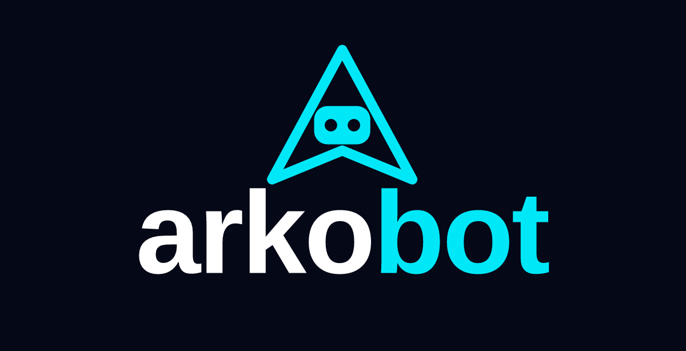

<p align="center"></p>

# ArkoBot

Um time de agentes de IA sempre ligados. Cada bot tem nome, personalidade, memória e computador próprios, e você aciona os bots como colegas de trabalho, pelo app, pelo WhatsApp ou por voz. Eles rodam com os modelos que você já paga (Claude Code e Codex logados no seu PC) e passam por aprovação antes de ações sensíveis.

O plano completo está em [`docs/otavio-bot/`](docs/otavio-bot/). O status da Fase 1 está em [`docs/otavio-bot/STATUS.md`](docs/otavio-bot/STATUS.md).

## O que tem neste repositório

| Pasta | O que é |
| --- | --- |
| `src/`, `server/`, `electron/` | App desktop e núcleo local (base: OpenMausBot, Apache-2.0) |
| `apps/portal/` | Portal web com as telas do protótipo (Prédio, Chat, Empresas, Conselho, Contratar bot, Extensões), por enquanto com dados de exemplo |
| `docs/otavio-bot/` | Arquitetura, roadmap e status |

## Rodar no seu PC

Você precisa do Node 24 ou mais novo e do pnpm 10. O pnpm vem pelo `corepack enable`.

```bash
pnpm install
```

```bash
pnpm dev:server
```

Em outro terminal:

```bash
pnpm dev
```

App desktop (Electron):

```bash
pnpm dev:desktop
```

Para os bots usarem as suas assinaturas, deixe o `claude` (Claude Code) e o `codex` instalados e logados no mesmo PC.

## Marca

O nome e o logo do ArkoBot ficam em [`docs/arkobot/`](docs/arkobot/): `mark.svg` é a fonte de todos os ícones (`node scripts/arkobot-icons.mjs` os regenera; a lista está em [`docs/arkobot/ICONES.md`](docs/arkobot/ICONES.md)). Um `brand.json` na pasta de dados ainda troca nome, logo, cor e favicon de uma instalação.

Por dentro, o código continua com os identificadores do OpenMausBot (comando `openmausbot`, pasta `~/.openmausbot`, variáveis `OMB_*`, `com.openmausbot.app`, esquema `openmausbot://`, cadeias de criptografia e protocolos), para seguir compatível com o projeto original, com o app do celular e com os dados já instalados. `scripts/testing/arkobot-identifiers.test.ts` garante que eles não mudem sem querer.

## Licença e origem

O ArkoBot é uma versão modificada do [OpenMausBot](https://github.com/milind-soni/OpenMausBot), distribuída sob a licença Apache-2.0 (veja `LICENSE` e `NOTICE`). A pasta `enterprise/` do projeto original não foi incluída. "OpenMausBot" e "MausBot" são marcas de terceiros, e o ArkoBot não tem ligação com elas. O README original está em [`docs/UPSTREAM-README.md`](docs/UPSTREAM-README.md).
