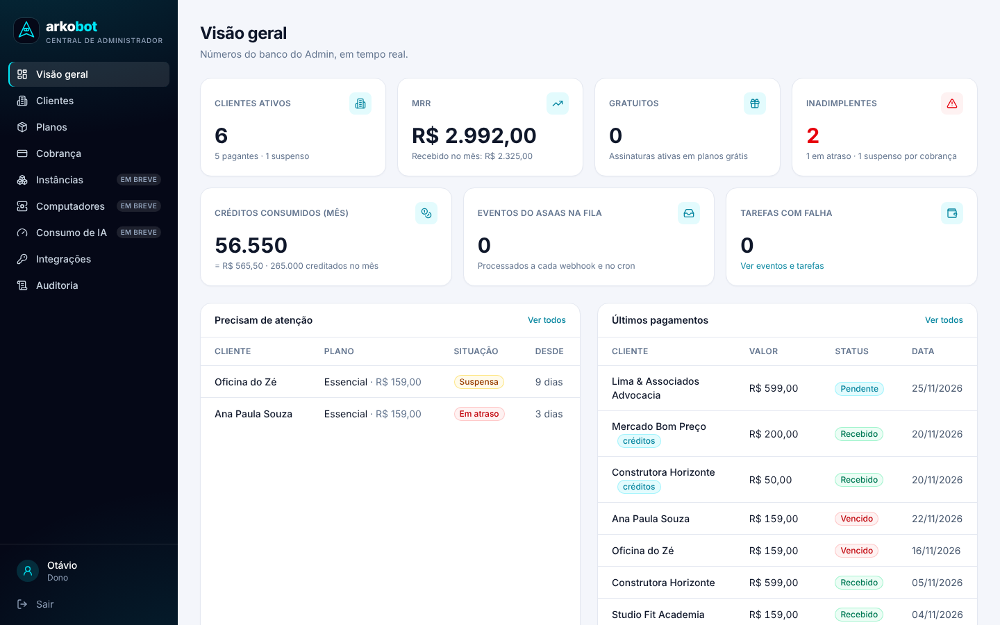
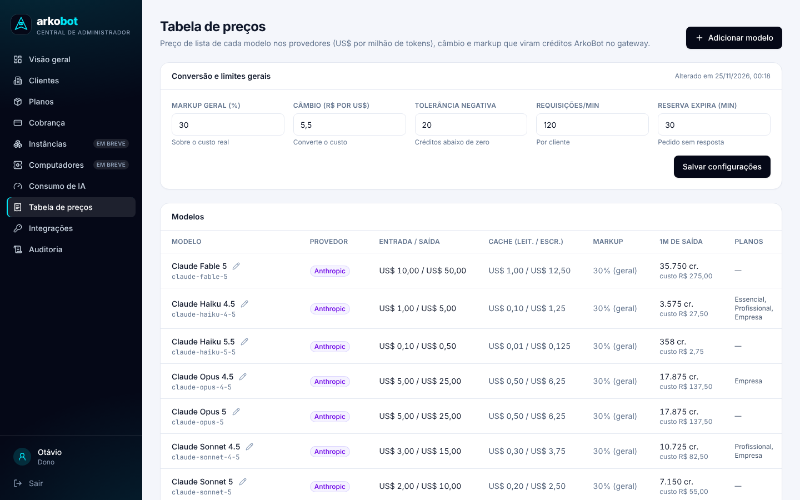

# ArkoBot · Central de Administrador

O painel interno da Domma Tecnologia para operar o ArkoBot como SaaS: clientes (CPF/CNPJ), planos, créditos ArkoBot (1 crédito = R$ 0,01), cobrança pelo Asaas, integrações e auditoria. Roda **separado das instâncias dos clientes**; os limites de uso só valem quando aplicados aqui e no gateway, nunca dentro da instância.

A **Parte 1** fez o painel, a cobrança e os créditos; a **Parte 2** acrescenta o [gateway de IA](#gateway-de-ia-parte-2), que cobra os créditos da IA paga pela Domma. O mesmo deploy também serve a [Área do cliente](#área-do-cliente-contaarkobotcombr) em `conta.arkobot.com.br`. O provisionamento das instâncias e os computadores (VPS) vêm nas próximas partes; o banco já tem as tabelas deles.



## Stack

| Peça | Escolha | Por quê |
| --- | --- | --- |
| API | [Hono](https://hono.dev) 4 em Node 22+ | Um só `app.fetch` roda igual no servidor Node (local, VPS, Docker) e numa função da Vercel; os testes chamam `app.request()` sem abrir porta. |
| Painel | React 19 + Vite + Tailwind 4 (SPA) | O mesmo conjunto do `apps/portal`; o painel é só para operadores, não precisa de SSR. O build é estático. |
| Banco | Postgres padrão via `DATABASE_URL` (`pg`) | Supabase, Neon, RDS ou o Postgres do VPS. Sem ORM: SQL explícito e migrações versionadas em `migrations/`. |
| Fila | Tabela `jobs` com `FOR UPDATE SKIP LOCKED` | Webhooks e tarefas não dependem de processo longo: o webhook grava e processa na hora; o que falhar fica na fila e o cron (`/api/cron/tick`) retoma. |
| Testes | Vitest + PGlite | Postgres de verdade compilado para WebAssembly, em memória: a suíte roda em qualquer máquina e no CI sem serviço de banco. Com `ADMIN_TEST_DATABASE_URL` a mesma suíte roda num Postgres real. |

Por que não Next.js: daria certo, mas o painel não ganha nada com SSR, e com Hono a mesma API serve a Vercel e um servidor Node comum sem adaptação (útil se o Admin for para um VPS da Domma).

## Estrutura

```
apps/admin
├── migrations/            0001_init.sql (todas as tabelas), 0002_planos_iniciais.sql, … 0008_plano_inicial.sql
├── src/
│   ├── auth/              login por e-mail + código, sessões, TOTP, limites de taxa
│   ├── billing/           BillingProvider, Asaas (asaas.ts), webhooks, régua, máquina de estados
│   ├── credits/ledger.ts  livro de créditos imutável e idempotente
│   ├── customer/          Área do cliente: login por código, cadastro, assinatura, créditos, LGPD (catalog.ts: termos, pacotes)
│   ├── gateway/           gateway de IA: proxy, reserva e liquidação, preços, tokens (processo próprio: node.ts)
│   ├── domain/            clientes, CPF/CNPJ, efeitos de status em cliente e instâncias
│   ├── jobs/              fila em Postgres e o "tick" do cron
│   ├── security/          AES-256-GCM (SecretBox), TOTP
│   ├── server/            app Hono, rotas, entradas Node (node.ts) e Vercel (vercel.ts)
│   ├── cli/               migrate, create-admin, run-jobs, seed-demo
│   ├── web/               painel React (index.html)
│   └── conta/             Área do cliente em React (conta.html), reaproveitando web/ui.tsx
├── test/                  testes (Vitest) e o Asaas falso
├── scripts/               dev, build da Vercel, screenshots
└── screenshots/           telas em 1440×900
```

## Rodar localmente

Requer Node 22.18+ (o repositório usa 24) e um Postgres (local, Docker ou Supabase).

```bash
pnpm install                                   # na raiz do monorepo
cp apps/admin/.env.example apps/admin/.env     # preencha (veja abaixo)
pnpm --filter admin migrate                    # cria/atualiza as tabelas
pnpm --filter admin create-admin voce@domma.com.br --name=Você
pnpm --filter admin seed:demo                  # opcional: clientes e pagamentos de exemplo
pnpm --filter admin dev                        # API em :8790, painel em http://localhost:5190 e Área do cliente em http://localhost:5191
```

Para o login, informe o e-mail; em desenvolvimento o código de 8 dígitos aparece no terminal da API (`[mailer:console]`).

Em modo "produção local": `pnpm --filter admin build && pnpm --filter admin start` serve API e painel juntos em `http://localhost:8790`.

Postgres rápido com Docker: `docker run -d -p 5432:5432 -e POSTGRES_PASSWORD=arko -e POSTGRES_USER=arko -e POSTGRES_DB=arko_admin postgres:16`.

### Variáveis de ambiente

| Variável | Obrigatória | O que é |
| --- | --- | --- |
| `DATABASE_URL` | sim | Postgres. Na Vercel use o **Transaction pooler** do Supabase (porta 6543). |
| `DATABASE_SSL` | não | `off`, `require` ou `verify`. Vazio: `off` em localhost, `require` no resto. |
| `ADMIN_ENCRYPTION_KEY` | sim | 32 bytes em base64. Cifra chaves do Asaas, tokens de webhook, chaves de IA, token da Hostinger, segredo do TOTP e segredos das instâncias. **Guarde em cofre: sem ela os segredos não abrem.** |
| `ADMIN_ENCRYPTION_KEY_PREVIOUS` | não | A chave anterior, só durante uma rotação (abre o que foi cifrado com ela). |
| `ADMIN_SESSION_SECRET` | sim | 32+ caracteres. Chave do HMAC dos códigos de login e dos limites de taxa. |
| `ADMIN_PUBLIC_URL` | sim em produção | Endereço do painel, ex.: `https://admin.arkobot.com.br`. Escritas só são aceitas vindas dessa origem; o cookie fica `Secure` quando é https. Também forma a URL do webhook. |
| `CUSTOMER_PUBLIC_URL` | não | Endereço da Área do cliente, ex.: `https://conta.arkobot.com.br` (padrão em produção; `http://localhost:5191` em desenvolvimento). Precisa ter host diferente de `ADMIN_PUBLIC_URL`. A API `/api/conta/*` só responde nesse host, e a API do painel, os webhooks e o cron nunca respondem nele. Também é lido no build da Vercel para servir `conta.html` nesse host. |
| `CUSTOMER_MAIL_FROM` | não | Remetente dos códigos da Área do cliente. Padrão: `ArkoBot <conta@arkobot.com.br>`. |
| `CRON_SECRET` | sim em produção | Protege `GET /api/cron/tick` (`Authorization: Bearer …`). A Vercel envia esse cabeçalho sozinha. |
| `ADMIN_CLIENT_IP_HEADER` | não | Cabeçalho com o IP real, escrito pela borda. Na Vercel já é `x-real-ip`. |
| `ADMIN_MAIL_FROM` | não | Remetente dos e-mails. |
| `RESEND_API_KEY` | sim em produção | Chave do [Resend](https://resend.com) (só envio, domínio `arkobot.com.br`). Sem ela os e-mails, inclusive os códigos de login, só vão para o log. |
| `DUNNING_SUSPEND_AFTER_DAYS` / `DUNNING_CANCEL_AFTER_DAYS` | não | Régua de inadimplência: 7 e 30 dias por padrão. |
| `ASAAS_API_BASE_URL` | não | Só desenvolvimento/testes: aponta o Asaas para um servidor falso. Recusado em produção. |

Gerar chaves:

```bash
node -e "console.log(require('crypto').randomBytes(32).toString('base64'))"     # ADMIN_ENCRYPTION_KEY
node -e "console.log(require('crypto').randomBytes(32).toString('base64url'))"  # ADMIN_SESSION_SECRET, CRON_SECRET
```

## Publicar (Vercel + Supabase)

1. **Banco.** Crie um projeto no Supabase. Em *Project Settings → Database*, copie a URL do **Transaction pooler** (`…pooler.supabase.com:6543/postgres`). Rode as migrações da sua máquina apontando para ela:
   ```bash
   DATABASE_URL='postgres://…:6543/postgres' pnpm --filter admin migrate
   ```
   As migrações ligam RLS em todas as tabelas sem nenhuma política: a API REST do Supabase (papéis `anon`/`authenticated`) não lê nada; o Admin conecta como dono das tabelas.
2. **Projeto na Vercel.** Importe o repositório com **Root Directory = `apps/admin`**. O `vercel.json` já define `pnpm run build:vercel`, que gera `.vercel/output` (Build Output API): o painel estático e **uma função Node** que atende `/api/*` e `/webhooks/*`, mais o cron `*/5 * * * *` em `/api/cron/tick`.
3. **Variáveis** (Production): `DATABASE_URL`, `ADMIN_ENCRYPTION_KEY`, `ADMIN_SESSION_SECRET`, `ADMIN_PUBLIC_URL`, `CRON_SECRET`, `RESEND_API_KEY`, `NODE_ENV=production`.
4. **Domínios**: `admin.arkobot.com.br` e `conta.arkobot.com.br` → o mesmo projeto (*Settings → Domains → Add*). No DNS de `arkobot.com.br`, um `CNAME` de `conta` para `cname.vercel-dns.com` (como o de `admin`). Defina `CUSTOMER_PUBLIC_URL=https://conta.arkobot.com.br` e faça um novo deploy: o build usa essa variável para mandar as páginas desse host para `conta.html`. Não ligue *Vercel Authentication* no projeto inteiro, porque a Área do cliente é pública; se quiser uma barreira extra para o painel, use regra de firewall só para o host `admin.`.
   Depois rode a migração `0005_area_do_cliente.sql` (`pnpm --filter admin migrate` com a `DATABASE_URL` de produção).
5. **Primeiro admin** (da sua máquina, com a `DATABASE_URL` de produção): `pnpm --filter admin create-admin seu@domma.com.br`. Depois entre e ligue o 2º fator em *Minha conta*.

Observações:
- Cron a cada 5 minutos exige plano Pro da Vercel; no Hobby o cron roda 1×/dia. Isso só atrasa retentativas e a régua, porque cada webhook já é processado na hora em que chega. Alternativa: chamar `/api/cron/tick` de outro agendador (ex.: cron do VPS) com o `CRON_SECRET`.
- Fora da Vercel: `pnpm --filter admin build && pnpm --filter admin start` (porta `PORT`, padrão 8790) atrás de um proxy https, e `pnpm --filter admin jobs -- --loop` (ou um cron chamando o tick).
- E-mail: com `RESEND_API_KEY` o envio é pelo Resend (`ResendMailer`); sem ela, o `ConsoleMailer` escreve o e-mail no log da função.

## Asaas

O código fala com a API v3 (`https://api.asaas.com/v3`, sandbox `https://api-sandbox.asaas.com/v3`, chave no cabeçalho `access_token`) por trás da interface `BillingProvider` (`src/billing/provider.ts`). As contas ficam na tabela `billing_accounts`; cada assinatura, pagamento e lançamento de crédito guarda o `billing_account_id` de onde veio, então dá para começar com a conta de **pessoa física** e passar para o **CNPJ da Domma** depois: basta cadastrar a nova conta e marcá-la como *ativa para novos*. Os clientes antigos continuam na conta antiga até serem migrados.

### Cadastrar a conta PF (sandbox primeiro)

1. Crie uma conta em <https://sandbox.asaas.com> (é separada da conta real) e gere a chave em *Integrações → Chaves de API* (começa com `$aact_`).
2. No painel: **Cobrança → Contas Asaas → Cadastrar conta**: titular *Pessoa física*, seu CPF, ambiente *Sandbox*, cole a chave, marque *Usar para novas assinaturas*.
3. O painel mostra **uma única vez** a URL e o token do webhook. No Asaas sandbox: *Integrações → Webhooks → Adicionar*:
   - URL: `https://admin.arkobot.com.br/webhooks/asaas/<id-da-conta>` (a que o painel mostrou);
   - Versão da API: v3; **Fila de sincronização**: ativada; tipo de envio: não sequencial;
   - **Token de autenticação**: o token mostrado (o Asaas manda no cabeçalho `asaas-access-token`);
   - Eventos: todos de **Cobranças** e de **Assinaturas**.
4. Clique em **Testar conexão** no cartão da conta. Crie um cliente de teste, inicie uma assinatura e pague-a no sandbox; o pagamento aparece em *Cobrança → Webhooks e fila* e os créditos entram no extrato do cliente.
5. Repita com a chave de produção (outra conta no painel, ambiente *Produção*) quando estiver tudo certo, e marque-a como ativa para novos.

Perdeu o token? *Novo token* no cartão da conta gera outro; atualize no Asaas.

### O que cada evento faz

| Evento | Efeito |
| --- | --- |
| `PAYMENT_CREATED` / `PAYMENT_UPDATED` | Registra a cobrança da assinatura. |
| `PAYMENT_CONFIRMED` / `PAYMENT_RECEIVED` | Pagamento confirmado: assinatura vai para *em dia*, o período avança e a **cota mensal** do plano é creditada (o que sobrou do plano no período anterior expira; créditos avulsos ficam). Compra avulsa: credita o saldo avulso. Os dois eventos para o mesmo pagamento creditam uma vez só. |
| `PAYMENT_OVERDUE` | Assinatura *em atraso*, instâncias marcadas `payment_problem`. Ignorado se o pagamento já foi confirmado (chegou fora de ordem). |
| `PAYMENT_REFUNDED` | Estorno: retira os créditos que aquele pagamento deu (até o que ainda houver no saldo). |
| `PAYMENT_CHARGEBACK_REQUESTED` / `_DISPUTE` | Retira os créditos e **suspende** o cliente (motivo chargeback). |
| `PAYMENT_DELETED` | Cobrança não paga removida. |
| `SUBSCRIPTION_DELETED` / `SUBSCRIPTION_INACTIVATED` | Assinatura cancelada aqui; cliente suspenso até ter outra. |

Cada evento é gravado bruto em `billing_events` (único por conta + id do evento, então reenvios do Asaas não duplicam) e processado numa transação que trava a linha: reprocessar é inofensivo. Créditos são idempotentes por `external_reference` (`payment:<id>:grant`, `payment:<id>:purchase`, …).

**Régua de inadimplência** (cron): vencida → *em atraso*; após 7 dias → cliente suspenso por cobrança (pagar reativa sozinho); após 30 dias → assinatura e cliente cancelados, com o cancelamento no Asaas feito por tarefa na fila. Suspensões manuais não são desfeitas por pagamento.

## Segurança

- Segredos (chaves de API, tokens de webhook, chaves de IA, token da Hostinger, segredo TOTP, segredo das instâncias) são cifrados com **AES-256-GCM**, IV aleatório e o contexto (tabela, coluna e id) como dado autenticado: um valor copiado para outra linha não abre. A tela mostra só uma impressão digital (12 caracteres do SHA-256).
- Login: código de 8 dígitos por e-mail, guardado como HMAC, vale 10 min e 5 tentativas; novo código substitui o anterior. Limites: 3 códigos por destinatário a cada 15 min e 5 pedidos/min por IP (a mesma regra do control plane), 10 verificações/min por IP. A resposta é igual para e-mail inexistente.
- 2º fator opcional (TOTP, qualquer aplicativo autenticador), com proteção contra reuso do código.
- Sessão: token aleatório em cookie `HttpOnly`, `Secure`, `SameSite=Strict`; o banco guarda só o hash. Expira em 12 h sem uso. Escritas precisam vir da origem `ADMIN_PUBLIC_URL`.
- Perfis: `owner` e `operator` alteram; `viewer` só lê.
- `audit_log` e `credit_ledger` têm gatilhos que recusam `UPDATE`, `DELETE` e `TRUNCATE`.
- `terms_acceptances` guarda versão, data, IP e navegador de cada aceite (gravado pela Área do cliente; o painel mostra no detalhe do cliente).

## Planos

A escada de planos: cada degrau acrescenta **um** diferencial (é a descrição do plano, que vira o título do cartão na Área do cliente). Criados pelas migrações `0002` e `0008` e editáveis em **Planos**:

| Plano | Preço | Diferencial | Créditos/mês | Bots | Empresas | VPS incluídos | Teste grátis | IA gratuita/dia |
| --- | --- | --- | --- | --- | --- | --- | --- | --- |
| Inicial (`inicial`) | R$ 39,00 | Assistente pessoal 24 h com IA gratuita | 0 | 1 | 1 | 0 | 7 dias | 200 requisições |
| Essencial | R$ 159,00 | Bots que trabalham sozinhos (rotinas + aprovações pelo WhatsApp) | 4.000 | 3 | 1 | 0 | — | — |
| Profissional | R$ 599,00 | Computador próprio na nuvem | 20.000 | 10 | 3 | 1 | — | — |
| Empresa | R$ 999,00 | Gestão de várias empresas | 40.000 | sem limite | sem limite | 2 | — | — |

O Inicial roda no servidor compartilhado (`cloud_mode = 'shared_limited'`), dorme após 30 min sem uso, 1 GB de RAM, 5 GB de disco, com navegador e sem computador; o Essencial também fica sem computador próprio (`computer_enabled = false`, pela `0008`). O Inicial não tem créditos: a IA dele é a **IA gratuita** do gateway (abaixo), só com os modelos marcados *grátis*; com `credits_per_month = 0` o gateway também não deixa o saldo ficar negativo (sem tolerância), então ele nunca usa IA paga "fiado".

Adicional: **computador individual (VPS)** a R$ 159,00/mês **por bot**, em todos os planos pagos (o Inicial incluído); muda o valor recorrente da assinatura no Asaas. Não há plano gratuito (`free`); o modelo continua suportando um. Todo plano tem `allow_byo_ai` (padrão ligado): o cliente pode usar a própria conta ou chave de IA, e esse uso não passa pelo gateway nem gasta créditos. Na Área do cliente, o painel sugere o próximo degrau (`PLAN_UPGRADES` em `src/customer/catalog.ts`); a troca de plano em si ainda é pelo WhatsApp.

## Teste grátis

`plans.trial_days` (0 a 90; o Inicial vem com 7) vale para qualquer plano pago. Na assinatura pela Área do cliente (`startSubscription`), se a organização **nunca teve teste nem pagou uma assinatura**:

- a assinatura nasce no Asaas com o **primeiro vencimento no fim do teste** (hoje + dias, data de Brasília);
- aqui ela fica `active` na hora, com `current_period_end` e `trial_ends_at` = fim do teste, e recebe os créditos do plano proporcionais aos dias (`ceil(cota × dias ÷ 30)`, referência `trial:<id>`; 0 no Inicial). O primeiro pagamento credita a cota cheia e expira o que sobrou do teste;
- **um teste por organização e por CPF/CNPJ**: `subscription_trials` (chave primária = documento, `organization_id` único) guarda cada teste para sempre, mesmo que a assinatura seja cancelada ou o documento da organização seja corrigido. Quem já pagou uma assinatura também não ganha teste.

Se a primeira cobrança não for paga, vale a régua normal: o `PAYMENT_OVERDUE` do Asaas leva a `past_due`, depois `suspended` e `canceled`. Se o aviso do Asaas não chegar, o cron marca o teste vencido e não pago como atrasado `TRIAL_GRACE_DAYS` (2) dias depois do fim. **Cancelar durante o teste** cancela no Asaas antes de qualquer cobrança, marca a fatura pendente como cancelada e não gera reembolso (a auditoria grava `duringTrial`).

A Área do cliente mostra "N dias grátis" no plano (só para quem ainda pode testar), o botão "Começar N dias grátis" e, no painel, "Teste grátis até dd/mm — a primeira cobrança vem em dd/mm". A ficha do cliente no painel mostra *Teste grátis até*.

## IA gratuita (plano Inicial)

O cliente do Inicial não precisa configurar nenhuma IA: o gateway atende com os **planos gratuitos** de provedores compatíveis com a API da OpenAI, nas contas da Domma.

- **Provedores**: Groq (`https://api.groq.com/openai/v1`), Google AI Studio/Gemini (`https://generativelanguage.googleapis.com/v1beta/openai`), NVIDIA (`https://integrate.api.nvidia.com/v1`), OpenRouter (só modelos `:free`) e Cerebras (`https://api.cerebras.ai/v1`, ainda sem chave: é pulado).
- **Chaves**: em **Integrações** (várias por provedor, por prioridade; a tela já preenche a URL base) e/ou nas variáveis do host do gateway `GROQ_API_KEY`, `GEMINI_API_KEY`, `NVIDIA_API_KEY`, `OPENROUTER_API_KEY` (`CEREBRAS_API_KEY` opcional). As do ambiente vêm depois das de Integrações e só servem os modelos grátis. Nenhuma chave vai para log ou para o banco em claro.
- **Modelos**: linhas de **Preços** com `free = true` (preço zero, `CHECK` no banco) e `upstream_model` (o id no provedor). A `0008` semeia os que responderam em 2026-11-26: `openai/gpt-oss-120b` (Groq), `gemini-3.8-flash`, `moonshotai/kimi-k3.1-pro` (NVIDIA), `nvidia/nemotron-3.5-super-vl:free` e `google/gemma-4-31b-it:free` (OpenRouter), `gpt-oss-120b` (Cerebras). `ARKOBOT_FREE_MODEL_<GROQ|GEMINI|NVIDIA|OPENROUTER|CEREBRAS>` troca o modelo de um provedor sem mexer na tabela. No OpenRouter, qualquer id sem `:free` é **bloqueado no código** (e por um `CHECK` no banco), porque seria cobrado da conta.
- **Ordem e queda**: o modelo pedido primeiro; se o provedor responder 429/5xx/401, não responder em `ARKOBOT_FREE_TIMEOUT_MS` (30 s) ou estiver sem vez no ritmo por minuto, passa para a próxima chave e depois para o próximo provedor, na ordem `ARKOBOT_FREE_AI_ORDER` (padrão `groq,gemini,nvidia,openrouter`). Ritmo por provedor neste processo: `ARKOBOT_FREE_RPM_<PROVEDOR>` (padrões 30, 10, 40, 20, 30). Se nenhum atender: `503 free_ai_unavailable` ("A IA gratuita está sobrecarregada agora…").
- **Limite por cliente**: `plans.free_requests_per_day` (Inicial: 200; 0 = sem IA gratuita, o padrão dos outros planos), por dia de Brasília: `429 free_daily_limit_reached` ("Limite diário da IA gratuita atingido — volta amanhã, ou faça upgrade / conecte sua própria IA"). Modelos grátis custam **0 crédito e não reservam** nada; ficam em `usage_events` com `provider`, `upstream_model` e `duration_ms` (e uma linha de log com provedor, modelo e latência). A ficha do cliente mostra *IA gratuita hoje*.
- **Na instância**: o catálogo (`/v1/models`) apresenta esses modelos como `provider: "openrouter"` (com `upstream_provider`), porque a instância só conhece os motores Anthropic, OpenAI e OpenRouter; o gateway aceita qualquer modelo compatível com OpenAI no caminho `/v1/openrouter/…`. Por isso os ids na tabela têm barra (`gratis/…`).
- **Conferir as chaves**: `pnpm --filter admin ia:testar` lê as quatro variáveis (do ambiente ou de `apps/admin/.env`), manda "Olá" a cada provedor com o modelo configurado e mostra OK/erro, status HTTP, latência e o começo da resposta, nunca a chave. Pula quem está sem chave.

**Atenção aos termos dos provedores.** Os planos gratuitos (Google AI Studio, catálogo de API da NVIDIA, modelos gratuitos do OpenRouter, Groq, Cerebras) têm limites de uso **compartilhados por toda a conta da Domma** e podem restringir uso comercial ou em produção, ou usar os dados enviados para treinar modelos. Confira os termos de cada um antes de vender o Inicial em escala. Se os gratuitos não bastarem, dá para trocar o Inicial para um modelo pago barato (ex.: `claude-haiku-5-5`) editando o plano: ponha o modelo em *Modelos permitidos* e dê créditos ao plano (`credits_per_month`), senão o gateway recusa com `402`.

## Testes

```bash
pnpm --filter admin test                                   # PGlite (em memória)
ADMIN_TEST_DATABASE_URL=postgres://u:s@127.0.0.1/db_teste \
  pnpm --filter admin test                                 # Postgres real (cada arquivo num schema próprio)
```

O gateway tem `test/gateway.test.ts` e `test/gateway-admin.test.ts`, com um provedor falso (`test/fake-ai.ts`: SSE da Anthropic e da OpenAI com usage, Responses, OpenRouter com custo): repasse do stream sem alteração, reserva e liquidação, concorrência (rajada de requisições simultâneas não estoura o saldo; rode também com `ADMIN_TEST_DATABASE_URL` para travas reais do Postgres), corte 402, tolerância negativa, modelo fora do plano, token revogado, plano suspenso/em atraso, idempotência, erro do provedor, troca de chave, cliente que cai no meio, tetos, avisos, rate limit, expiração de reservas e as telas do painel.

Cobrem: cifra (ida e volta, adulteração, contexto, rotação de chave), TOTP (vetores do RFC 6238), login por código e seus limites, 2º fator, sessões revogadas/expiradas, permissões (anônimo, viewer, origem, cron), cliente Asaas contra um servidor falso (`test/fake-asaas.ts`), idempotência de webhook e de créditos (inclusive corrida), transições da assinatura, estorno, chargeback, régua de inadimplência, adicionais e a fila de tarefas com `SKIP LOCKED`.

A Área do cliente tem `test/customer.test.ts`: login por código e limites, separação de hosts (cookie do cliente não abre o painel e vice-versa, origem das escritas), validação do cadastro e gravação dos aceites, cadastro → assinatura no Asaas falso → fatura → webhook, compra de créditos, computadores adicionais, cancelamento, exportação, pedido de exclusão e isolamento entre organizações.

O plano Inicial tem `test/trial.test.ts` (teste grátis: vencimento no Asaas, assinatura ativa, texto do painel, créditos proporcionais, um teste por organização e por CPF/CNPJ, régua depois do teste, cancelamento durante o teste) e `test/free-ai.test.ts` (IA gratuita: catálogo, 0 crédito sem reserva, limite diário, troca de chave e de provedor, chaves/ordem/modelo/ritmo/tempo pelo ambiente, bloqueio de OpenRouter sem `:free`, Inicial fora dos modelos pagos e sem tolerância negativa, planos pagos como antes). `test/plans.test.ts` confere que a `0008` roda de novo sem mudar nada.

A cortesia tem `test/courtesy.test.ts`: liberação com créditos na hora, recusa com assinatura paga, troca da assinatura pendente (cancelada no Asaas pela fila), renovação mensal idempotente, fim pela data (dia de Brasília) e pelo operador, régua que não a toca, permissões e o que a Área do cliente mostra.

Screenshots: com o painel rodando e dados de demonstração, `pnpm --filter admin screenshots` (usa o Playwright com Chromium).

## Área do cliente (conta.arkobot.com.br)

O cliente se cadastra, assina e acompanha a conta sozinho. Roda no **mesmo deploy** do painel, separado pelo host:

| | Painel (`admin.`) | Área do cliente (`conta.`) |
| --- | --- | --- |
| Página | `index.html` (`src/web`) | `conta.html` (`src/conta`) |
| API | `/api/*`, `/webhooks/*`, `/api/cron/*` | só `/api/conta/*` |
| Cookie | `arko_admin_session`, `SameSite=Strict` | `arko_conta_session`, `SameSite=Lax` |
| Escritas aceitas da origem | `ADMIN_PUBLIC_URL` | `CUSTOMER_PUBLIC_URL` |

Os dois cookies são `HttpOnly`, `Secure` e sem `Domain` (valem só no próprio host), e o banco guarda só o hash do token. Em qualquer outro host a API do cliente responde 404; no host do cliente, a do painel também. `Lax` no cliente é para ele continuar logado ao voltar da página de pagamento do Asaas.

**Fluxo**
1. **Entrar / criar conta** (`/entrar`, `/cadastro?plano=inicial|essencial|profissional|empresa`): só e-mail; código de 8 dígitos com as mesmas regras e limites do login do painel (3 códigos por e-mail a cada 15 min, 5 pedidos/min e 10 verificações/min por IP, 5 tentativas, 10 min). A conta (`accounts`) só é criada quando o código confere. Sessão de 7 dias, renovada com o uso.
2. **Boas-vindas**: nome, celular, empresa (CPF ou CNPJ com dígitos verificadores) e o aceite obrigatório dos [Termos de Uso](https://arkobot.com.br/termos/) e da [Política de Privacidade](https://arkobot.com.br/privacidade/). Cada documento vira uma linha em `terms_acceptances` com versão, IP (`ADMIN_CLIENT_IP_HEADER`/`x-real-ip`) e navegador. Cria a organização com a conta como `owner`. As versões ficam em `src/customer/catalog.ts` (`LEGAL_DOCUMENTS`, hoje `2026-11-25`); um teste confere com a data "em vigor a partir de" dos textos em `apps/site/conteudo/legal/`. **Ao mudar um texto, mude a data lá**: quem aceitou a versão anterior precisa aceitar de novo no próximo acesso.
3. **Plano**: plano (pré-escolhido pelo site), computadores adicionais (R$ 159/mês cada) e Pix, boleto ou cartão. Cria a assinatura no Asaas pela conta *ativa para novos* (`startSubscription` + `setSubscriptionAddon`) e mostra o link da primeira fatura. O cartão é digitado na página do Asaas; nunca passa por aqui. Sem conta Asaas ativa, a tela diz que os pagamentos ainda não estão disponíveis e leva ao WhatsApp.
4. **Painel**: situação da assinatura (pendente, em dia, em atraso, suspensa, cancelada) com o próximo passo, pagamentos com o link da fatura/boleto/Pix, saldo de créditos (plano e avulsos) e extrato, compra de pacotes de créditos (`CREDIT_PACKAGES`: 5.000, 10.000 e 25.000 créditos = R$ 50, R$ 100 e R$ 250), quantidade de computadores adicionais, cancelamento (com motivo; marca na auditoria se foi dentro dos 7 dias de arrependimento, para o reembolso manual), exportação dos dados (JSON) e pedido de exclusão.

**Pedido de exclusão**: grava `account_deletion_requests` e a auditoria; nada é apagado sozinho. No painel, a ficha do cliente mostra um aviso e a aba *Pedidos de exclusão*, onde o operador registra o que fez (*Atendido* ou *Recusado*). Pagamentos, notas, o extrato de créditos e a auditoria ficam pelo prazo legal.

Cada cliente só enxerga a própria organização: nenhuma rota recebe id de organização; tudo sai da `memberships` da conta da sessão. Um membro (`member`) só lê; mudanças de cobrança são do `owner`/`admin`. Cada conta pode gerar até 10 cobranças por hora.

Em desenvolvimento, `pnpm --filter admin dev` abre a Área do cliente em `http://localhost:5191` (use `localhost`, não `127.0.0.1`, porque a API compara o host com `CUSTOMER_PUBLIC_URL`).

## Cortesia

Para liberar um plano **sem cobrança** (parceiro, teste estendido, compensação): na ficha do cliente, **Liberar sem cobrança (cortesia)** → plano, *Válida até* (padrão *Sem prazo*) e motivo (obrigatório). Só `owner` e `operator`; o `viewer` não vê o botão e a API recusa. Precisa da migração `0006_cortesia.sql` (`pnpm --filter admin migrate`).

- Cria uma assinatura `active` marcada `courtesy`, com preço 0, sem conta Asaas e sem assinatura no Asaas (um `CHECK` do banco garante isso), período de agora a +1 mês e a cota do plano creditada na hora (`courtesy:<id>:<início do período>`). Se o cliente estava suspenso por cobrança ou assinatura encerrada, volta a ficar ativo. A auditoria guarda quem liberou e o motivo.
- Assinatura **paga** em andamento (em dia, em atraso ou suspensa): recusa; cancele-a antes, para nunca derrubar um cliente pagante sem querer. Assinatura **aguardando o 1º pagamento** (por exemplo, criada na Área do cliente): é cancelada aqui, as faturas em aberto viram canceladas e o cancelamento no Asaas sai pela fila (`billing.cancel_provider_subscription`).
- **Renovação** no cron: ao fim de cada período, a cota do mês seguinte entra como numa renovação paga (o que sobrou do plano expira, avulsos ficam), uma vez por período. A régua de inadimplência ignora cortesias.
- **Fim**: no dia seguinte a *Válida até* (horário de Brasília) ou em **Encerrar cortesia** (com motivo), a assinatura é cancelada ("Cortesia encerrada") e o cliente fica suspenso por assinatura encerrada, como num `SUBSCRIPTION_DELETED`; na Área do cliente aparece *Assinar de novo*. Os créditos que sobraram continuam no saldo.
- Computadores adicionais não entram na cortesia: os adicionais entram no valor da assinatura e no MRR, e a cortesia não tem cobrança. Os incluídos no plano valem normalmente.
- **Área do cliente**: conta como assinatura em dia (painel, créditos e gateway funcionam) e mostra "Plano X — cortesia (sem cobrança)" e a data final, sem valor, faturas nem forma de pagamento. Cancelar e mudar computadores mandam falar com a equipe pelo WhatsApp; comprar créditos avulsos segue a regra de sempre (precisa de conta Asaas ativa).
- Na Visão geral a cortesia não conta como pagante; as listas de clientes e de assinaturas mostram o selo *cortesia*.

## Gateway de IA (Parte 2)

A IA paga pela Domma passa por um gateway que é o **único lugar confiável** para os limites: a instância do cliente não é confiável, então ela só recebe um token (`arko_ai_…`) e manda tudo para o gateway, que confere plano, modelo, saldo e tetos, repassa ao provedor com as chaves da Domma (`ai_provider_keys`) e debita os créditos. O uso com a conta ou chave do próprio cliente (`allow_byo_ai`) não passa por aqui e não gasta créditos.


### Onde roda e por quê

O gateway é um **processo Node separado** (`src/gateway/node.ts`), no mesmo pacote do Admin porque usa o mesmo banco e os mesmos módulos (livro de créditos, cifra das chaves, planos). Ele **não** roda na Vercel: uma resposta em streaming de um agente pode durar muitos minutos, e uma função serverless corta em 60–300 s, o que cortaria a resposta no meio e deixaria a liquidação para trás. No VPS da Domma ele fica atrás de um proxy HTTPS (o Caddy do `deploy/`) que não faz buffer do SSE. O painel continua na Vercel; os dois falam só pelo Postgres.

```
instância ArkoBot ──(token arko_ai_…)──▶ gateway (VPS) ──(chave da Domma)──▶ Anthropic / OpenAI / OpenRouter
                                          │  reserva → repassa o stream sem mexer → lê o usage → liquida
                                          ▼
                                       Postgres (o mesmo do Admin) ◀── painel (Vercel): consumo, preços, tokens
```

### Endpoints

| Rota | O que faz |
| --- | --- |
| `POST /v1/anthropic/v1/messages` | Messages API (com ou sem `stream`). `…/v1/messages/count_tokens` é repassado sem cobrar. |
| `POST /v1/openai/v1/chat/completions` e `/v1/openai/v1/responses` | Chat Completions e Responses (com streaming). |
| `POST /v1/openrouter/v1/chat/completions` | OpenRouter e, para a instância, qualquer modelo compatível com OpenAI da tabela (Gemini, NVIDIA, Groq, Cerebras). |
| `POST /v1/{google,nvidia,groq,cerebras}/v1/chat/completions` | Direto num provedor compatível com OpenAI. |
| `GET /v1/models` (e `/v1/{provedor}/v1/models`) | O catálogo do plano: modelos da tabela de preços permitidos pelo `allowed_models` do plano, mais `organization` e `usable`. |
| `GET /health` | Saúde (consulta o banco). |

Autenticação: `Authorization: Bearer arko_ai_…` ou `x-api-key` (o Claude Code manda um dos dois). O token é guardado só como SHA-256 e resolve cliente e instância. Cabeçalhos opcionais: `X-Arko-Company` e `X-Arko-Bot` (atribuição no painel) e `X-Arko-Request-Id` (idempotência: o mesmo id duas vezes dá `409 duplicate_request`). A resposta traz `X-Arko-Request-Id`.

O corpo e o stream da resposta vão ao cliente **byte a byte como o provedor mandou**. O gateway só mexe no pedido para: pedir o uso no stream (`stream_options.include_usage` na OpenAI/OpenRouter, `usage.include` no OpenRouter) e baixar `max_tokens`/`max_output_tokens` quando o saldo ou o teto por requisição não pagam o pedido inteiro.

### Créditos: reserva e liquidação

1. **Reserva** (`credit_reservations`), numa transação que trava a carteira do cliente: estimativa = entrada (bytes do pedido ÷ 4, a preço de entrada) + `max_tokens` × preço de saída, convertida em créditos. O disponível é `saldo − reservas ativas + tolerância negativa`; duas requisições simultâneas passam uma de cada vez por essa trava, então a segunda vê a reserva da primeira e não gasta os mesmos créditos. Saldo ≤ 0: `402 credits_used_up` na hora.
2. **Repasse** ao provedor, pela chave de maior prioridade; 401/429/5xx antes de qualquer byte ao cliente passa para a próxima chave.
3. **Liquidação** ao fim do stream (ou da resposta), lendo o `usage`: Anthropic `message_start` + `message_delta.usage` (entrada, cache lido, cache escrito, saída); OpenAI `usage` do último chunk / `response.completed`; OpenRouter `usage.cost` (o custo informado pelo provedor tem prioridade). Custo em US$ × câmbio × (1 + markup) → créditos, arredondado para cima. Débito no `credit_ledger` (imutável) primeiro do saldo do plano e depois do avulso (que pode ficar negativo até a tolerância), com referência `usage:<request_id>:plan|extra`: liquidar duas vezes não debita duas vezes. A sobra da reserva volta (a reserva é marcada `settled`).
4. Se o cliente cai no meio do stream, cobra-se o que o provedor já informou mais uma estimativa da saída pelos bytes entregues (`usage_estimated` no painel). Erro do provedor: nada é cobrado, a reserva é liberada e o status/corpo do provedor vão ao cliente. Reservas de um gateway que caiu expiram no cron (`/api/cron/tick`).

Tetos do plano: **diário** (dia de Brasília), **mensal** (no período da assinatura) e **por requisição** (baixa o `max_tokens`; se nem a entrada cabe, `400 request_over_plan_limit`). Rate limit por cliente (requisições/minuto, `429` com `Retry-After`). Avisos de **50, 80 e 100%** da cota do período ficam em `usage_alerts` e na auditoria, uma vez por período; o e-mail ao cliente entra pela interface `UsageAlertNotifier` (`src/gateway/alerts.ts`), em cima do `Mailer`, quando o provedor de e-mail for escolhido.

Recusas (corpo JSON `{ code, message, type, error }`, mensagem em pt-BR):

| Status | `code` | Quando |
| --- | --- | --- |
| 401 | `invalid_token` | Token desconhecido, revogado ou expirado. |
| 402 | `plan_suspended` | Cliente suspenso/cancelado ou assinatura que não está em dia (em atraso, suspensa, aguardando 1º pagamento). |
| 402 | `credits_used_up` | Saldo acabou (ou não cobre nem a entrada). |
| 402 | `daily_cap_reached` / `monthly_cap_reached` | Teto do plano. |
| 400 | `request_over_plan_limit` | Pedido maior que o teto por requisição. |
| 403 | `model_not_in_plan` / `model_unavailable` | Modelo fora do plano / desativado ou de outro provedor. |
| 409 | `duplicate_request` | `X-Arko-Request-Id` repetido. |
| 429 | `rate_limited` | Limite por minuto. |
| 429 | `free_daily_limit_reached` | Limite diário da IA gratuita do plano. |
| 503 | `free_ai_unavailable` | Nenhum provedor gratuito atendeu (todos no limite ou fora do ar). |

### Painel

- **Consumo de IA**: requisições, custo real da Domma (R$ e US$), créditos cobrados e margem, por cliente, empresa, bot e modelo, recusas por motivo e as últimas requisições. Filtra por período e por cliente (`/consumo?cliente=<id>`).
- **Tabela de preços**: preço por modelo (entrada, saída, cache lido/escrito, US$ por milhão), markup próprio opcional, saída máxima estimada, ativo/inativo, e os gerais: markup, câmbio R$/US$, tolerância negativa, requisições/minuto e validade da reserva. Partiu de `server/model-prices.ts` (migração `0003`). Tudo auditado.
- **Ficha do cliente → Gateway de IA**: emitir token (mostrado uma única vez) por instância, revogar com motivo, consumo dos últimos 30 dias.
- A Visão geral perdeu o cartão "Gratuitos" (não há plano grátis) e ganhou "Margem de IA (mês)".



### Rodar o gateway

Local: `pnpm --filter admin gateway` (porta `GATEWAY_PORT`, padrão 8791; usa `DATABASE_URL` e `ADMIN_ENCRYPTION_KEY` do `.env`).

No VPS (Docker + Caddy com HTTPS automático):

```bash
cd apps/admin/deploy
cp gateway.env.example gateway.env        # DATABASE_URL e ADMIN_ENCRYPTION_KEY: as mesmas do Admin
GATEWAY_DOMAIN=ia.arkobot.com.br docker compose -f gateway.compose.yml up -d --build
```

A imagem (`Dockerfile.gateway`) leva só o gateway empacotado num arquivo (`pnpm --filter admin build:gateway` → `dist/gateway/gateway.mjs`) e o Node 24. Use a conexão direta ou o *Session pooler* do Supabase (processo longo). Sem Docker: `node dist/gateway/gateway.mjs` atrás de qualquer proxy HTTPS que não faça buffer de `text/event-stream`. Ao receber SIGTERM o gateway espera os streams em andamento liquidarem antes de sair.

Depois: cadastre as chaves da Domma em **Integrações** (Anthropic, OpenAI, OpenRouter e, para a IA gratuita, Groq, Google AI Studio, NVIDIA; ou as variáveis `*_API_KEY` do `gateway.env`), confira a **Tabela de preços** e os `allowed_models` dos **Planos**, e emita um token na ficha do cliente.

### Lado da instância

No servidor do ArkoBot, `OMB_CLOUD_AI_GATEWAY_URL` (raiz do gateway, https) e `OMB_CLOUD_AI_GATEWAY_TOKEN` (o `arko_ai_…`) ligam o caminho "gateway ArkoBot" (`server/hosted-models.ts`): a instância lê `/v1/models` e registra os motores **ArkoBot · Claude** (Claude Code com `ANTHROPIC_BASE_URL` no gateway), **ArkoBot · Codex** e **ArkoBot · OpenRouter** ao lado dos motores do dono, que continuam funcionando como antes. O token segue o caminho dos tokens incluídos: chega pelo pipe de segredos do Cloud, sai do ambiente do servidor na partida, nunca vai para `config.json` nem aparece na lista de motores. Como nos motores de empresa, o processo do Claude Code/Codex recebe o token no próprio ambiente para falar com o gateway; um token vazado só gasta os créditos do próprio cliente e é revogado na ficha. Um 402/403 do gateway vira uma nota no chat ("Os créditos de IA do seu plano acabaram…", traduzida), com o botão para conectar a própria IA. O catálogo é relido a cada 15 minutos; token revogado tira os motores.

## Próximas partes

- **Instâncias**: provisionar o contêiner `cloud-home` por cliente (`OMB_CLOUD_*`), nó compartilhado do modo limitado, saúde e pareamento assinados.
- **Gateway**: e-mail dos avisos de 50/80/100% (`UsageAlertNotifier`), emissão automática do token no provisionamento da instância, preços por faixa de contexto longo.
- **Computadores (VPS)**: interface `VpsProvider` com a Hostinger primeiro (`vps_machines`, `vps_provider_accounts`).
- Troca de plano com pró-rata (também na Área do cliente), emissão de NFS-e quando a conta PJ estiver ativa, convites de membros para a organização.
