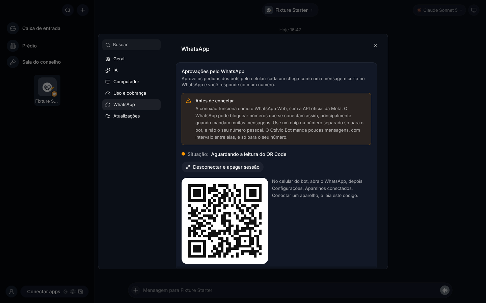
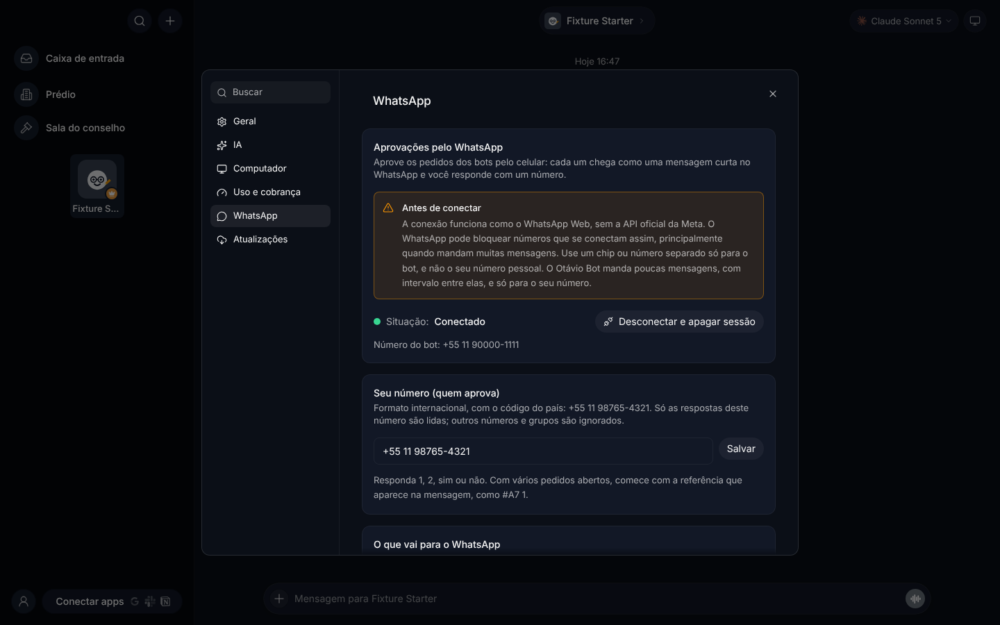

# Aprovações pelo WhatsApp

Com o WhatsApp ligado, quando um bot precisa da sua resposta, você recebe uma mensagem curta no seu WhatsApp e responde com um número. A resposta vale igual a um clique no app.



## O que chega no seu WhatsApp

- **Aprovações e pedidos dos bots.** O cartão "Enviar em seu nome?" (quando um bot quer mandar algo por um app conectado, inclusive os que caem nas regras da empresa), os pedidos de permissão para fazer algo, as perguntas que o bot faz antes de agir e o cartão "Liberar a empresa para continuar gastando neste mês?" da verba.
- **Verba da empresa a 80% e 100%.** O mesmo aviso que aparece no app.
- **Bot com problema.** Quando uma tarefa falha ou trava. Vem desligado; ligue se quiser.

Você escolhe cada um em Configurações → WhatsApp → "O que vai para o WhatsApp".

Não vão para o WhatsApp: propostas que precisam ser revisadas na tela (habilidades, rotinas, mudanças no perfil ou no modelo do bot, montagem de equipe, servidores MCP), pedidos de senha ou login, perguntas com várias partes e cartões de salas com vários bots. Esses continuam só no app.

## Antes de conectar: o risco

A conexão funciona como o WhatsApp Web, lendo um QR Code. Ela não usa a API oficial da Meta. O WhatsApp pode bloquear números que se conectam assim, principalmente quando mandam muitas mensagens.

Por isso:

- **Use um chip ou número separado só para o bot.** Não use o seu número pessoal. Se o número do bot for bloqueado, o seu continua intacto.
- O Otávio Bot manda poucas mensagens: só para o seu número, uma de cada vez, com alguns segundos entre elas e no máximo 30 por hora.
- Ele nunca responde a outros números, grupos ou status.

## Como conectar

1. Tenha à mão o celular com o chip do bot e o WhatsApp instalado nele.
2. No Otávio Bot, abra **Configurações → WhatsApp**.
3. Em **Seu número (quem aprova)**, digite o **seu** número (o que vai receber e responder), com o código do país: `+55 11 98765-4321`. Clique em **Salvar**.
4. Clique em **Conectar**. Aparece um QR Code.
5. No celular **do bot**, abra o WhatsApp, depois **Configurações → Aparelhos conectados → Conectar um aparelho**, e leia o QR Code.
6. A situação muda para **Conectado** e mostra o número do bot.

Pronto. O servidor fica conectado sozinho, inclusive depois de reiniciar. Se a internet cair, ele tenta de novo, esperando um pouco mais a cada vez.



## Como responder

Cada mensagem traz a empresa, o bot, o que ele quer fazer, as opções numeradas e uma referência, por exemplo:

```
🔔 #A7 · RedBox · Ana
Enviar em seu nome?
Gmail: enviar e-mail para 3 contatos

1 Aprovar · 2 Recusar
Responda com o número, ex.: 1. Com vários pedidos abertos: #A7 1
```

Você pode responder:

- `1` ou `2` (o número da opção);
- `sim` ou `não`;
- o texto da opção, como `Liberar até o fim do mês`.

Se houver mais de um pedido esperando, comece com a referência: `#A7 1`. Se você mandar só `1` com vários pedidos abertos, o bot pergunta qual deles.

Depois da sua resposta, chega a confirmação, por exemplo `✔ #A7: Aprovar. Feito, igual a no app.`

Se você resolver o pedido no app antes, chega o aviso `✔ #A7 resolvido no app` e a mensagem original ganha essa mesma linha (o WhatsApp só deixa editar mensagens recentes, então o aviso separado vale sempre). Uma resposta que chegue depois disso é ignorada, e o bot avisa que nada foi feito.

## Segurança

- Só as respostas do número que você colocou em "Seu número (quem aprova)" são lidas. O número é comparado só pelos dígitos (com ou sem o 9 extra dos celulares do Brasil). Outros números, grupos e status são ignorados, sem resposta.
- Uma resposta pelo WhatsApp passa pelas mesmas checagens de um clique no app e não tem mais poder do que ele: não existe "sempre permitir" pelo WhatsApp.
- No registro de **Configurações → Atividade**, a decisão aparece como tomada "pelo WhatsApp".
- As mensagens passam pelo mesmo filtro que esconde senhas e chaves nas prévias do app.
- A sessão do WhatsApp (as chaves da conexão) fica no servidor, na pasta de dados do app, em `whatsapp/session`, com permissão só para o usuário do servidor. Ela nunca vai para os logs, para os celulares pareados, nem para os backups do workspace.
- Só o dono ou um admin vê e muda esta seção. O QR Code só aparece para eles.

## Desconectar

Em **Configurações → WhatsApp**, clique em **Desconectar e apagar sessão**. O aparelho sai da lista de aparelhos conectados do celular do bot e a sessão é apagada do servidor. Para voltar, conecte de novo com um novo QR Code.

Se você tirar o aparelho pelo celular (Aparelhos conectados → Desconectar), o app mostra **Sessão encerrada pelo celular** e apaga a sessão. É só conectar de novo.

Quem não liga o WhatsApp não é afetado: nada se conecta e a biblioteca do WhatsApp nem é carregada.

## Para quem cuida do servidor

- Biblioteca: [Baileys](https://github.com/WhiskeySockets/Baileys) `@whiskeysockets/baileys` 7.0.0-rc14 (licença MIT), que fala o protocolo do WhatsApp Web direto, sem navegador, e roda num servidor Linux sem tela. Ela usa a `libsignal` 6.0.0, que tem licença **GPL-3.0**: quem distribuir o servidor com ela deve seguir os termos da GPL-3.0 para essa parte (o código-fonte do Otávio Bot já é aberto).
- Os arquivos ficam em `<pasta de dados>/whatsapp/`: `settings.json` (seu número e os avisos escolhidos) e `session/` (a sessão, pasta 0700 e arquivos 0600).
- O teste de ponta a ponta (`server/whatsapp.e2e.test.ts`) roda num servidor isolado com um WhatsApp de mentira (`server/testing/fake-whatsapp.ts`), sem conectar ao WhatsApp de verdade.
